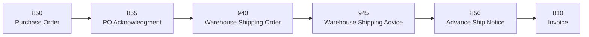

# X12 Order Lifecycle Checker

Follows each order through its EDI documents and points out where it got stuck.

> **Status:** working on the sample data. Parser, checks and report are done and tested.

---

## The problem

Before a retail order gets paid, it moves through a chain of EDI documents. Different systems send each one: the retailer, the supplier's ERP, and the warehouse.



The receiver of every document also sends back a **997 Functional Acknowledgment** to say "I got it and could read it."

| Document | What it is | From | To |
|---|---|---|---|
| 850 | Purchase order | Retailer | Acme |
| 855 | PO acknowledgment (accept, change or reject) | Acme | Retailer |
| 940 | Warehouse shipping order ("please ship this") | Acme | Warehouse |
| 945 | Warehouse shipping advice ("this is what we shipped") | Warehouse | Acme |
| 856 | Advance ship notice (ASN) | Acme | Retailer |
| 810 | Invoice | Acme | Retailer |
| 997 | Functional acknowledgment | Receiver | Sender |

Each system only sees its own step. If one document never goes out, usually no alarm goes off. The order just stops moving. Most of the time people find out late: from a chargeback, a partner asking where their ASN is, or an invoice that never got paid.

This tool looks at **the whole chain for each order** and flags the ones that broke.

## What it reads

A folder of X12 files, one transaction per file, for a made-up company:

- **Acme Home Goods**: the supplier, a home goods brand
- **Retail partners** (all fictional): Bluebird Home Stores, Maple & Pine Market, Tidewater Living
- **Warehouse** (fictional 3PL): Riverbend Fulfillment

The tool reads the envelopes (ISA / GS / ST) and the key segments of each file, then groups the documents into one order by **PO number**.

## What it checks

| Check | What it means | Example |
|---|---|---|
| **Missing next document** | A step happened, but the next one never did | 945 received but no 856 sent; 856 sent but no 810 |
| **Missing 997** | A document was never acknowledged | 850 received but no 997 sent back |
| **Quantity mismatch** | Units don't line up between steps | Invoiced more than shipped, or shipped more than ordered |
| **Late document** | A step happened, but past its time limit | 855 sent 30 hours after the 850 |
| **No activity** | The order has gone quiet | PO received 8 days ago, nothing since |

### Default time limits

These are starting values for the demo. You can change all of them.

| From | To | Limit |
|---|---|---|
| Any document | Its 997 | 24 hours |
| 850 | 855 | 24 hours |
| 850 | 940 | 24 hours |
| 940 | 945 | 3 days |
| 945 | 856 | 48 hours |
| 856 | 810 | 48 hours |
| Last document | Any next document | 7 days (no activity) |

## What it produces

This is real output on the sample data, shortened.

**1. A summary and a list of problems**, grouped by type, so someone can work through it like a to-do list:

```
X12 ORDER LIFECYCLE REPORT
As of 2026-03-07 18:00  |  folder: sample_data
12 orders: 7 with problems, 4 done, 1 open

PROBLEMS (7)
  MISSING   PO 4500012  Bluebird Home Stores   945 received, no 856 sent
  MISSING   PO 4500082  Tidewater Living       856 sent, no 810 sent
  QTY       PO 4500031  Maple & Pine Market    invoiced 50 > shipped 48 for AHG-1003
  QTY       PO 4500070  Maple & Pine Market    shipped 26 > ordered 24 for AHG-1001
  LATE      PO 4500044  Tidewater Living       855 sent 30h after 850 (limit 24h)
  NO 997    PO 4500050  Bluebird Home Stores   850 received, no 997 sent
  QUIET     PO 4500057  Tidewater Living       no activity for 8 days, waiting on 855, 940
```

**2. A timeline for each order**, listing every document with its date, time and units. Problems are marked `!!`. For an order that is still moving, `..` shows what is due next and by when:

```
PO 4500012  Bluebird Home Stores  [PROBLEM]
  2026-03-02 09:14  850 received   120 units
  2026-03-02 09:15  997 sent      for 850
  2026-03-02 15:40  855 sent       120 units
  2026-03-02 15:45  997 received  for 855
  2026-03-03 08:00  940 sent       120 units
  2026-03-03 08:05  997 received  for 940
  2026-03-05 17:22  945 received   118 units
  2026-03-05 17:23  997 sent      for 945
  !! MISSING  945 received, no 856 sent

PO 4500063  Maple & Pine Market  [OPEN]
  ...
  2026-03-07 10:05  945 received    24 units
  2026-03-07 10:06  997 sent      for 945
  .. waiting  856 due by 2026-03-09 10:05
```

Each order is labeled **PROBLEM**, **DONE** (invoiced with no problems) or **OPEN** (still moving, nothing overdue). Files that could not be read, and 997s that match no document, are listed at the end.

## How to run it

It's a small Python command line tool with no extra packages to install (Python 3.10 or newer). From the repo root:

```
python -m x12_checker sample_data --as-of "2026-03-07 18:00"
```

| Option | What it does |
|---|---|
| `--as-of "YYYY-MM-DD HH:MM"` | Check the folder as of this moment. The default is now. Documents dated later are ignored, so you can replay how any past day looked. |
| `--problems-only` | Only show timelines for orders with problems. |
| `--names FILE` | JSON file that maps X12 IDs to partner names. The default is `partners.json` inside the folder. Without one, the report shows the raw IDs. |

Two smaller views are handy while testing:

```
python -m x12_checker.checks sample_data --as-of "2026-03-07 18:00"   # problem list only
python -m x12_checker.parser sample_data                              # every document, in time order
```

To run the tests:

```
python -m unittest discover tests
```

### Project layout

| Path | What's in it |
|---|---|
| `x12_checker/parser.py` | Reads X12 files and links each 997 to the document it acknowledges |
| `x12_checker/checks.py` | Groups documents by PO and applies the time limits and quantity rules |
| `x12_checker/report.py` | Builds the summary, problem list and timelines |
| `tools/make_sample_data.py` | Writes the fake X12 files in `sample_data/` |
| `sample_data/` | 123 fake X12 files, partner names, and the answer key |
| `tests/` | Tests for all three parts, including one that pins the answer key |

## Roadmap

- [x] Fake X12 sample files for Acme Home Goods, covering clean orders and broken ones (see [sample_data](sample_data/))
- [x] Parser that reads each file, pulls out the key fields, and links each 997 to the document it acknowledges
- [x] Checks for missing, late, quantity, missing 997 and quiet orders
- [x] Timeline and problem list reports
- [ ] Next project: an SQL order-to-cash database built on the same Acme data

## About the data

Every company, trading partner, SKU, PO number and person in this project is made up. No real trading partner data is used. Any match to a real business is a coincidence.

## About me

I've spent 6+ years in order-to-cash: testing ERP order flows end to end, then running EDI for retail partners as a Logistics & Systems Manager. This project is the check I always wanted between those systems.
